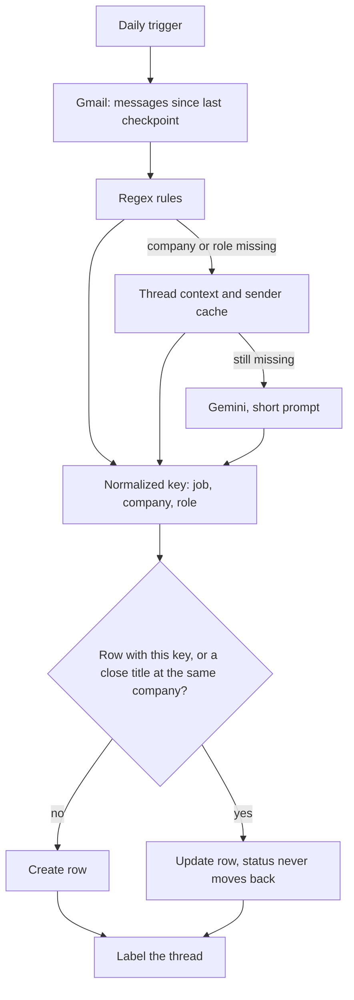

# gmail-assistant

Turns your Gmail inbox into a job-search dashboard in Notion, automatically.

Every morning a Google Apps Script reads new emails about job applications and paid
subscriptions, works out the company, role and status, and keeps one clean row per job in
a Notion database. Applying twice to the same job, rejections arriving as replies, and
`(m/w/d)` versions of the same title all end up in the same row. A Follow Up column flags
the applications that are worth a polite nudge.

It runs on your own Google and Notion accounts. There is no server, no subscription, and
no one else sees your data.

## What you get

- **One row per job**, with First Seen, Last Email, Status, Times Applied, Rejected Date and
  the rejection reason the email gave.
- **Status that only moves forward.** A late confirmation email never overwrites "Interviewing".
- **A Follow Up flag.** "Applied" rows with no news for 10 to 30 days, minus ATS portals and
  any big employers you list.
- **Subscriptions too.** Trials, receipts, cancellations and expiries for any paid service.
- **Low or zero AI cost.** Regex rules handle most emails. Gemini is only asked when the rules,
  the email thread and a learned sender cache cannot name the company and role. Set
  `USE_AI: false` to run with rules only.

## How it works



A few details that keep it reliable:

- **Messages, not threads.** It reads every message newer than a stored checkpoint, so a
  rejection that replies to an old confirmation is still picked up.
- **Nothing is lost.** The checkpoint only moves past a message after it is handled. Failed
  Notion or Gemini calls are retried on the next runs, then the thread gets a `Needs_Review` label.
- **Re-runs are safe.** Re-reading an older message never overwrites newer state.
- **Duplicates are merged by key.** Legal suffixes (GmbH, Inc, Group), gender tags and
  requisition numbers are stripped. Titles at the same company that share at least 80% of
  their words (ignoring city names) count as the same job, but "Senior QA Engineer" and
  "QA Engineer" never merge.

## Setup (about 10 minutes)

1. **Notion.** Create an empty full-page database. Create an internal integration at
   <https://www.notion.so/profile/integrations>, copy its token, then in the database open
   `...` > Connections and add the integration. Copy the database ID from its URL
   (the 32 characters before `?v=`).
2. **Gemini (optional).** Get a free API key at <https://aistudio.google.com/apikey>.
   Skip this step if you set `USE_AI: false`.
3. **Apps Script.** At <https://script.google.com> create a project, then add one script file
   per file in `src/` (`Config`, `Code`, `Setup`, `Migrate`) and paste their contents.
   `Migrate` is only needed if you are importing an old messy database.
4. **Secrets.** In Project Settings > Script Properties, add `NOTION_TOKEN`,
   `NOTION_DATABASE_ID` and, if you use AI, `GEMINI_API_KEY`. Never paste secrets into the code.
5. **Run once, in this order:** `setupNotion` (creates the columns and the formula),
   `processInbox` (approve the Gmail permissions prompt), then `installDailyTrigger`.
   To import older mail, run `startBackfill` and then `processInbox` until the log finds 0 messages.

Then add these views in Notion by hand (the Notion API cannot create views):

| View | Setup |
|---|---|
| Companies | Filter Type is Job Application, group by Name |
| Follow up | Filter Follow Up is checked, sort Last Email ascending |
| Pipeline | Board, group by Status |
| Rejected | Filter Status is Rejected, sort Rejected Date descending |
| Subscriptions | Filter Type is Subscription |

## Configure

Everything you are meant to change is in [`src/Config.js`](src/Config.js): search keywords
(English and German included), the follow-up window, companies to never flag for follow-up,
company aliases, and the AI switch. After editing the `FOLLOW_UP_*` settings, run
`setupNotion` again to rewrite the formula.

Useful one-offs in `Setup.js`: `clearSenderCache` forgets learned sender-to-company mappings,
`startBackfill` re-reads older mail.

## Privacy

- Your emails stay in Gmail. Notion only gets the company, role, status, dates, sender,
  subject and a one-line rejection reason.
- With `USE_AI: true`, the sender, subject and the first 1,000 characters of the body of
  emails the rules cannot resolve are sent to the Gemini API. Check Google's current Gemini
  API terms for how inputs are used on the free tier, or set `USE_AI: false`.
- Keys live in Script Properties, never in the code, and the Gemini key is sent as a header,
  never in a URL.

## Cost

Apps Script and the Notion API are free for personal use. With AI on, expect a handful of
Gemini calls a day, fewer over time as the sender cache fills, within the free tier.

## Development

The Apps Script files run unchanged under Node with in-memory fakes for Gmail, Notion and
Gemini:

```bash
npm test
```

No dependencies. Node 18 or newer.

## License

MIT, see [LICENSE](LICENSE).
